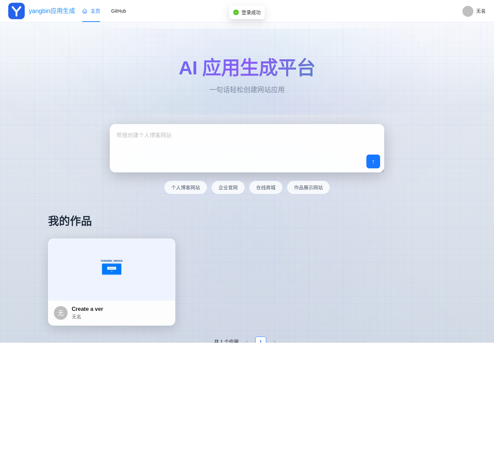

# yangbin AI 应用生成平台

通过自然语言生成 HTML、多文件网站和 Vue 项目，支持流式对话、应用预览、代码下载、发布及截图。

维护者：yangbin / BStronger1。基于课程代码适配，来源、原作者及历史说明见 [NOTICE.md](NOTICE.md)。

## 目录

- src：Spring Boot 单体后端（本次部署入口）
- yangbin-ai-code-mother-frontend：Vue 3 + TypeScript 前端
- yangbin-ai-code-mother-microservice：保留的微服务实现
- sql/create_table.sql：数据库表结构
- deploy/turing：用户级部署、启动、验收脚本

## 运行

需要 Java 21+、Node.js 20.19+ 或 22.12+、MySQL/MariaDB 和 Redis。
模型支持兼容 Chat Completions 的接口，密钥通过环境变量或服务器私有配置提供。

后端：mvn -Dtest=CodeParserTest package
前端：在前端目录执行 npm ci 和 npm run build
部署步骤见 [部署说明](deploy/turing/README.md)。

本次更名覆盖 Java 包路径、类名、Maven 模块、前端名称、数据库名和页面品牌。
上游署名集中保留在 NOTICE.md。

## 模型与存储

- AI_BASE_URL、AI_API_KEY、AI_MODEL：普通对话及流式代码生成
- AI_REASONING_MODEL：复杂 Vue 项目生成，默认与 AI_MODEL 相同
- AI_ROUTING_MODEL：应用类型选择，默认与 AI_MODEL 相同
- 截图默认保存在服务器本地；COS 作为可选配置保留
- Pexels 图片搜索、DashScope 图片生成需要各自服务密钥，未配置时不可用

不得将 .env、私有 application 配置、数据库、运行日志或模型密钥提交到仓库。

## 验收与界面

构建、真实模型与重启验证见 [验收记录](docs/VALIDATION.md)。

