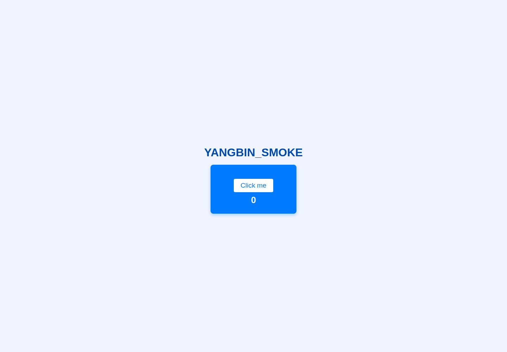

# 验收记录

验收日期：2026-10-14（Asia/Singapore）。

- 单体后端：生产 JAR 构建通过，CodeParserTest 两项测试通过。
- 前端：TypeScript 检查和 Vite 生产构建通过。
- 微服务：父项目及七个模块全部编译打包通过，未部署或进行集成运行验收。
- turing 单体部署：数据库、Redis、Java 后端和前端代理正常运行。
- 真实模型：复用服务器私有配置中的 gpt-4.1-mini。
- 端到端：注册、登录、应用创建、SSE 代码生成、预览、发布、ZIP 下载和本地截图通过。
- Chromium：实际表单登录、首页、应用对话页、直接刷新与生成页面按钮交互通过，无页面 JavaScript 异常。
- 持久化：停止并重启本项目后，登录会话、应用记录和发布页面验证通过。
- 用户开机条目已安装；没有重启整台服务器，因此不宣称完成整机重启验收。
- 凭据：提交候选文件的密钥特征扫描无命中；运行配置和数据目录排除在 Git 之外。

截图为独立测试账号生成的合成样例，不含真实用户数据。

追加验收：多文件和 Vue 模式各完成一个真实模型生成、构建与发布案例；Chromium 验证两种页面均成功渲染，计数按钮均能交互。完整结果见 mode-acceptance.json 和 browser-acceptance.json。

验收后已清理独立合成账号及三个测试作品，保留无密钥的验收记录和截图。
Pexels、DashScope 图像工具仍需单独配置服务密钥。
